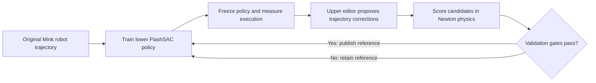

# UniRetarget

Learn a robot motion reference using feedback from a physics-trained motor policy.

**UniRetarget** is an experimental bi-level retargeting workflow.
The **lower level** trains a FlashSAC motor policy to follow a robot reference in Newton
physics. The **upper level** edits that reference using feedback from the frozen motor
policy, then resumes lower training with an accepted edit. The demonstrated object motion
and contact targets stay fixed. The current manipulation pilot uses Vega arms with Sharpa
hands on the tissue-box sequence.

**[Read the UniRetarget guide](robotic_grounding/flash_chord/UNIRETARGETING.md)**:
[how to run](robotic_grounding/flash_chord/UNIRETARGETING.md#run-it) ·
[upper optimization explained](robotic_grounding/flash_chord/UNIRETARGETING.md#upper-level-optimization) ·
[code map](robotic_grounding/flash_chord/UNIRETARGETING.md#code-map) ·
[results and videos](robotic_grounding/flash_chord/UNIRETARGETING.md#inspect-a-run).

| Start with | What it explains |
| --- | --- |
| [Training entry point](robotic_grounding/flash_chord/scripts/train_flash_sac.py) | Creates the scene, lower learner, and optional upper editor. |
| [Upper trajectory editor](robotic_grounding/flash_chord/src/flash_chord/retargeting/ttsa_editor.py) | Proposal parameterization, upper actor/critic, physical reward, and acceptance gates. |
| [Physical rollout](robotic_grounding/flash_chord/src/flash_chord/retargeting/manipulation_bilevel.py) | Runs the frozen lower policy and measures task, tracking, and contact errors. |
| [Lower training loop](robotic_grounding/flash_chord/src/flash_chord/training/flash_sac/runner.py) | Trains FlashSAC, invokes the upper editor, and switches reference versions. |
| [Pilot findings](robotic_grounding/flash_chord/UNIRETARGETING_PENETRATION_PILOT.md) | What the tissue-box experiments established and what remains unproven. |

The implementation uses alternating two-time-scale learning with simulator-scored proposals.
It does not differentiate through simulation or a converged lower policy. The pilot demonstrates
runnable reference editing; reliable physical-overlap and end-to-end performance gains remain
to be established. Experiment data and checkpoints must be supplied separately from Git.

## How it works



1. **Train the lower policy.** FlashSAC learns residual joint-position commands around
   the current robot reference. Object tracking and contact objectives define the task.
2. **Freeze and measure.** Pause lower learning and evaluate physical execution without
   virtual object control (VOC) assistance.
3. **Optimize the upper editor.** Each upper action proposes a correction to the entire
   trajectory. A small FlashSAC actor/critic learns from the candidate's physical cost
   improvement. An optional geometry search proposes a finger edit for the first trial.
4. **Validate the candidate.** Check object tracking, stability, overlap, and total cost
   against the current reference using fresh physical rollouts.
5. **Publish and continue.** Save an accepted reference with its checksum, rebuild its
   consumers, and resume lower learning. Clear lower replay at every upper boundary.

### Upper optimization at a glance

| Component | Current implementation |
| --- | --- |
| Observation | Original trajectory statistics, current correction, object/task errors, and 16 temporal bins of signed hand/object feedback; overlap feedback when enabled. |
| Action | Whole-trajectory coefficients: three smooth temporal modes × 24 Vega/Sharpa joint channels = 72 values for the `smooth` editor. |
| Other bases | `per_frame` provides smoothed interior-frame corrections; `global_local` adds four localized temporal windows. |
| Bounds | At most 0.12 rad joint offset and 0.5 rad/s added velocity, joint limits enforced, first/last configurations preserved. |
| Blending | Default 25% proposed correction plus 75% current correction, anchored to the original trajectory. |
| Reward | Current cost minus candidate cost, clipped to [-5, 5]. Each physical trial is one terminal upper transition. |
| Cost | Object position/orientation error, success fraction, robot tracking, optional wrench support and penetration, instability, and edit regularization. |
| Selection | Best eligible trial when enabled; otherwise deterministic upper actor output. Fresh validation must pass the gates and strictly improve cost. |
| Schedule | Full pilot: 3,276,800 lower transitions per block, eight upper trials, four upper-evaluation worlds. |

See the [detailed upper optimization walkthrough](robotic_grounding/flash_chord/UNIRETARGETING.md#upper-level-optimization)
for equations, exact gates, network settings, and links to each corresponding function.
The [lower-level walkthrough](robotic_grounding/flash_chord/UNIRETARGETING.md#lower-level-and-reference-updates)
explains reference publication, replay clearing, and checkpoint metadata.

## How to run

Use Linux, Docker with NVIDIA GPU support, Git LFS, and the
[FlashCHORD container prerequisites](robotic_grounding/flash_chord/README.md#setup).
Full pilot training is configured for a 48 GiB GPU.

```bash
# From the repository root.
git lfs install
git lfs pull
cd robotic_grounding/flash_chord
docker/run.sh build

# Supply the materialized tissue-box asset tree before starting the container.
export V2D_ASSETS_DIR=/absolute/path/to/tissue_box
docker/run.sh start latest 0
```

The asset tree must contain the tuned Vega/Sharpa parquet, its object meshes, and support
assets. It is mounted at `/v2d/assets`; the original experiment tree is
`/data1/SRL_V2D/.e2e/tissue_box`. These experiment assets are supplied separately from Git.

Run the commands in the guide inside the container at `/workspace`:

| Run | Instructions |
| --- | --- |
| Prepare data | [Expected input paths and sequence requirements](robotic_grounding/flash_chord/UNIRETARGETING.md#1-prepare-the-container-and-sequence-assets) |
| Check the online loop | [32-world, 4,096-transition smoke test](robotic_grounding/flash_chord/UNIRETARGETING.md#2-run-a-short-online-wiring-test) |
| Train both levels | [Full 98,304,000-transition schedule and matched controls](robotic_grounding/flash_chord/UNIRETARGETING.md#3-run-the-full-lowerupper-schedule) |
| Reuse a trained policy | [Frozen lower-policy editing pilot](robotic_grounding/flash_chord/UNIRETARGETING.md#4-test-an-edit-against-an-existing-frozen-lower-policy) |
| Evaluate and visualize | [Unassisted evaluation, MP4 rendering, and penetration diagnostics](robotic_grounding/flash_chord/UNIRETARGETING.md#inspect-a-run) |

Set `bilevel.engine=ttsa_flashsac` to select the neural upper editor. Historical mode names
`fixed`, `reactor`, and `reactor_wrench` select the control/upper-wrench condition;
the mode name alone does not select the optimization algorithm.

## Where to see results

Runs are saved under `robotic_grounding/flash_chord/outputs/` on the host:

| Artifact | What it shows |
| --- | --- |
| `ttsa_manifest.json` | Upper-loop settings, bounds, basis, and penetration configuration. |
| `upper_updates.jsonl` | Baseline and candidate scores, validation results, accepted edits, reference versions, and upper simulation budget. |
| `references/reference_NNNN.npz` | Original and accepted robot-reference snapshots. |
| `policy_STEP.safetensors` | Lower policy with metadata identifying its reference snapshot. |
| `upper/` | Saved upper learner state and replay artifacts. |
| `evaluation_unassisted.json` | Metrics produced by the evaluation command. |
| `rollout.mp4` | Physical execution produced by the video command. |
| `guided_report.json` | Frozen-policy pilot comparison. |

Copy reference snapshots together with checkpoints when sharing runs. Full joint
upper/lower training resume is currently unsupported.

## Current status

The [penetration pilot report](robotic_grounding/flash_chord/UNIRETARGETING_PENETRATION_PILOT.md)
records runnable upper editing and reduced kinematic reference overlap. Reliable improvements
in physical overlap and end-to-end task performance still need to be demonstrated.

The current visual proxy assumes one rigid object and uses its convex hull. Joint bounds
and relative acceptance gates do not certify collision-free or dynamically feasible motion.
Study evaluation uses a deterministic lower actor and a fixed reset seed, so fresh validation
rollouts do not establish performance on independent reset conditions. See the
[implementation limitations](robotic_grounding/flash_chord/UNIRETARGETING.md#current-evidence-and-limitations)
before interpreting pilot results.
