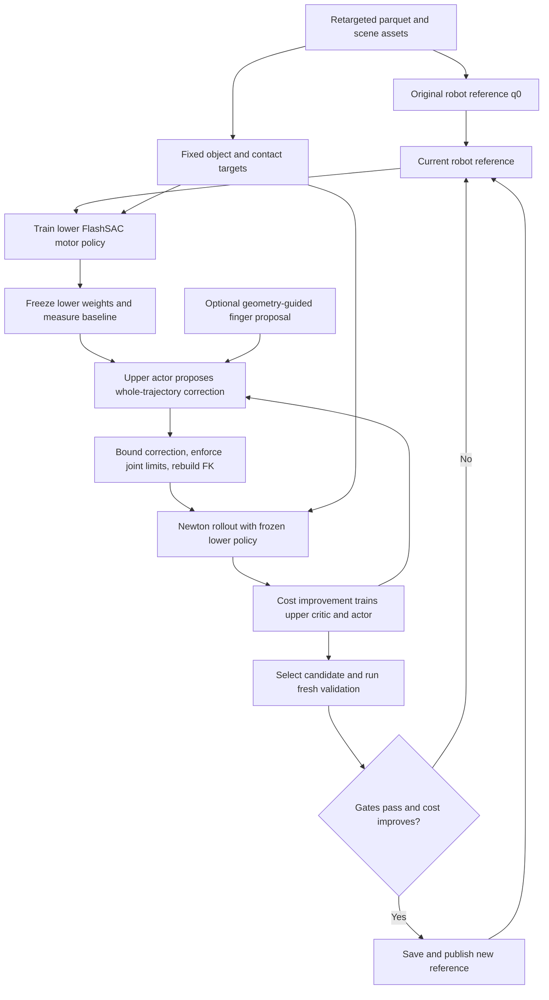

# UniRetargeting

UniRetargeting learns a robot motion reference together with a policy that can execute it.
The current pilot starts from a Mink IK trajectory for Vega arms and Sharpa hands manipulating
a tissue box. The upper level proposes bounded changes to the robot trajectory. The lower
FlashSAC policy tests those changes in Newton physics and continues learning after an edit
is accepted. Object poses, contact labels, meshes, and demonstration timing define the task
and are held fixed.

This guide describes the code in this repository, including its experimental limitations.
Read the overview and code map first; use the run section when the sequence assets are available.

- [How the two levels fit together](#how-the-two-levels-fit-together)
- [Code map](#code-map)
- [Upper level optimization](#upper-level-optimization)
- [Lower level and reference updates](#lower-level-and-reference-updates)
- [Run it](#run-it)
- [Inspect a run](#inspect-a-run)
- [Current evidence and limitations](#current-evidence-and-limitations)

## How the two levels fit together

| Quantity | Meaning | Changes when? |
| --- | --- | --- |
| `q0[t, j]` | Original robot joint trajectory from Mink IK | Immutable during a run. |
| `q_ref[t, j]` | Currently published robot reference | Only after an upper candidate passes validation. |
| `phi` | Lower motor-policy parameters | Each lower FlashSAC training block. |
| `theta` | Upper trajectory-editor actor/critic parameters | During physical proposal trials at an upper update. |
| Object/contact commands | Demonstrated manipulation target | Immutable during both levels. |



Conceptually, the lower problem learns `phi` for a supplied reference, and the upper problem
seeks a reference that improves the resulting manipulation. The implemented approximation
alternates finite lower training blocks with upper trials against **frozen lower weights**.
The upper actor learns through a learned critic. There is no backpropagation through Newton
or through the lower training procedure, and no claim that the lower policy has converged.

The upper output is one reusable reference for the sequence. At deployment, the lower motor
policy executes with that reference; the upper network does not issue motor commands per step.

## Code map

All paths below are relative to `robotic_grounding/flash_chord/`. Search for the named
function or class in each linked file; these names are more stable than line numbers.

| Part | File and entry point | What to read there |
| --- | --- | --- |
| Wire the two levels | [scripts/train_flash_sac.py](scripts/train_flash_sac.py), `main` | `cfg.bilevel`, editor construction, `reference_update` callback. |
| Lower training schedule | [runner.py](src/flash_chord/training/flash_sac/runner.py), `_run_training` | Callback after lower collections; environment replacement and replay clearing. |
| Upper loop | [ttsa_editor.py](src/flash_chord/retargeting/ttsa_editor.py), `TTSAReferenceEditor.__call__` | Baseline → trials → selection → validation → publication. Read this first for the algorithm. |
| Upper observation | [ttsa_editor.py](src/flash_chord/retargeting/ttsa_editor.py), `observation`, `signed_feedback_summary` | Trajectory statistics, signed error over time, current edits, penetration feedback. |
| Upper action | [ttsa_editor.py](src/flash_chord/retargeting/ttsa_editor.py), `study_basis`, `candidate_joint_q`, `make_binding` | Temporal modes × joint channels, blending, projection, FK. |
| Upper learner | [ttsa_editor.py](src/flash_chord/retargeting/ttsa_editor.py), `prepare_upper` | Small FlashSAC actor/critic and terminal bandit transitions. |
| Upper score and gates | [ttsa_editor.py](src/flash_chord/retargeting/ttsa_editor.py), `upper_cost`, `passes_study_gate` | Exact coefficients, units, and publication thresholds. |
| Geometry proposal | [ttsa_editor.py](src/flash_chord/retargeting/ttsa_editor.py), `guided_action` | Discrete search over finger channels before physical scoring. |
| Frozen lower evaluation | [manipulation_bilevel.py](src/flash_chord/retargeting/manipulation_bilevel.py), `rollout` | Unassisted Newton execution, object/robot/wrench metrics, signed feedback. |
| Penetration measurement | [penetration.py](src/flash_chord/retargeting/penetration.py), `VisualHullPenetration`, `HandObjectPenetration` | Visual overlap proxy and collision-shape alternative. |
| Reference contract | [binding.py](src/flash_chord/embodiments/binding.py), `build_robot_reference_binding` | Joint targets and FK-derived wrist/fingertip reference arrays. |
| Save/load reference | [reference_snapshot.py](src/flash_chord/retargeting/reference_snapshot.py) and [setup.py](src/flash_chord/scene/setup.py) | Versioned NPZ, checksums, source-command identity, scene loading. |
| Lower actor/critic updates | [learner.py](src/flash_chord/training/flash_sac/learner.py), `create_learner` | Shared FlashSAC learning machinery used by both levels. |
| Lower objective | [tracking.py](src/flash_chord/objectives/tracking.py) and [wrench.py](src/flash_chord/objectives/wrench.py) | Robot/object tracking and contact-wrench support rewards. |
| Robot/training recipe | [dexmate_sharpa_flash_sac.yaml](src/flash_chord/configs/experiment/dexmate_sharpa_flash_sac.yaml) | Embodiment, controller, observation, objective, simulator, and lower defaults. |
| Frozen-policy pilot | [optimize_uniretargeting_reference.py](scripts/optimize_uniretargeting_reference.py) | Test one upper editing step using an existing lower checkpoint. |
| Inspect penetration | [diagnose_uniretargeting_penetration.py](scripts/diagnose_uniretargeting_penetration.py) | Per-frame collision and optional visual overlap reports. |
| Evaluate / render | [evaluate_policy.py](scripts/evaluate_policy.py), [view_policy.py](scripts/view_policy.py) | Unassisted metrics and videos from lower checkpoints. |

**Engine versus mode:** `bilevel.engine=ttsa_flashsac` selects the neural editor described here.
The default engine uses the earlier `ManipulationBilevel.__call__` search with the
[reactor.py](src/flash_chord/retargeting/reactor.py) body-map primitives. Those are separate
upper update algorithms. In either engine, the historical mode names mean:

| `bilevel.mode` | Behavior |
| --- | --- |
| `fixed` | Keep the reference fixed while matching outer evaluation/reset boundaries. |
| `reactor` | Edit the reference with upper wrench weight zero. |
| `reactor_wrench` | Edit the reference with upper wrench weight one by default. |

The mode name alone does not identify the algorithm. Set `engine` explicitly.

## Upper level optimization

### 1. Freeze the lower policy and build the observation

At `warmup` lower environment transitions, and then every `interval`, the editor pauses
lower learning and evaluates the currently published reference. It uses four evaluation
worlds by default. Upper evaluation disables virtual object control (VOC), which is the
training assistance that applies forces/torques to the object.

The observation includes the original joint trajectory's mean and standard deviation,
the current mean joint correction, and baseline object-position, orientation, success,
and wrench errors. With `study_variant` set, it also includes **16 temporal bins** of
signed hand/object-relative errors: mean and standard deviation across worlds, separated
by hand and XYZ direction. Sixteen bins of the current joint correction preserve when an
edit occurs. Penetration-aware runs append overlap summaries and temporal overlap bins.

The spread matters: opposing errors in different worlds can have zero mean while still
indicating poor execution. The policy receives both mean and spread.

### 2. Parameterize a whole-trajectory correction

For the Vega/Sharpa pilot, the joint basis `S` has **24 channels**: seven individual arm
joints and five finger-flexion synergies per side. A finger synergy couples that finger's
non-`AA` joints. These names and the geometry-guided channel indexing are embodiment-specific.

The upper actor emits a flattened coefficient matrix `A`. A temporal basis `B` turns it
into a joint correction:

```text
A:          [number of temporal modes, 24]
B:          [number of frames, number of temporal modes]
S:          [24, number of robot joint coordinates]
delta_raw = B @ clip(A, -1, 1) @ S
```

| `study_variant` | Temporal basis | Action dimension for T frames |
| --- | --- | ---: |
| `smooth` | Three sine modes, `sin(k*pi*phase)`, k = 1, 2, 3 | 72 |
| `per_frame` | One coefficient per interior frame, smoothed with Gaussian sigma 2 frames | `24*(T-2)` |
| `global_local` | Three sine modes plus four local Gaussian windows | 168 |

`global_local` disables local coefficients in round one. At round two, it fixes the four
local centers using remaining systematic signed error, or penetration scores when enabled.
It falls back to phases 0.2, 0.4, 0.6, 0.8 if fewer than four centers are found.

`bounded_correction` globally rescales the proposed correction to a maximum **0.12 rad**
offset and **0.5 rad/s added velocity**. It preserves the first and last configurations.
`candidate_joint_q` then blends it with the current correction:

```text
delta_blended = (1 - blend) * (q_ref - q0) + blend * delta_bounded
q_candidate  = project_reference(q0, delta_blended)
```

The default `blend` is 0.25. Every proposal remains anchored to the immutable `q0`;
successive edits cannot accumulate unlimited drift. `project_reference` clips joint limits
and contracts the correction again because joint clipping can introduce velocity spikes.
`make_binding` recomputes joint targets and FK-derived robot reference arrays.

### 3. Optionally propose a geometry-guided finger edit

With `guided_penetration_proposal=true`, `guided_action` searches one temporal mode and
one finger channel at a time, in both signs, with default coefficient amplitude 0.32.
The amplitude is an upper coefficient, **not** the final joint offset in radians.
It measures sampled reference frames at stride 32 by default and ranks them by:

```text
reference_overlap_mean / 0.005 + 0.5 * reference_overlap_peak / 0.05
```

The search rejects a reference peak-overlap increase above 0.5 mm. A better geometry
proposal takes the first physical trial's place; the other trials come from the upper actor.
This requires `penetration_aware=true`, `penetration_measure=visual_hull`,
`select_best_trial=true`, and `study_variant=smooth` or `global_local`.

The geometry search itself uses FK and geometry. The frozen lower policy must still execute
the resulting candidate in physics, and it must pass the same publication gates.

### 4. Score candidates with physical execution

`ManipulationBilevel.rollout` runs the frozen lower actor for the sequence. For the
recommended `study_variant=smooth` configuration, `upper_cost` uses:

```text
J = object_position_robust_m / 0.03
  + object_orientation_robust_rad / 0.3
  + 2 * (1 - object_success_robust_fraction)
  + 0.1 * robot_position_robust_mse / 0.02**2
  + wrench_weight * wrench_robust_mse
  + penetration_weight * (
        reference_penetration_mean_m / 0.005
      + 0.5 * rollout_penetration_mean_m / 0.005)
  + 3 * unstable_world_fraction
  + 0.05 * mean((delta / 0.12)**2)
  + 0.05 * mean((diff(delta) * fps / 0.5)**2)
```

Here `delta = q_candidate - q0`. The scales are fixed code constants. Robust summaries
weight worlds equally and cap individual position errors at 1 m, orientation at pi,
wrench mismatch at 10, and squared robot-position components at `0.1**2`.
The success fraction counts samples with object position error below 0.1 m and orientation
error below 0.5 rad. An unstable world exceeds 1 m object-position error at any step.
These are upper-loop diagnostics, not official benchmark success metrics.

Wrench error is normalized **contact-wrench support mismatch**, averaged over active
reference-contact frames; it does not measure total force/torque error. Setting
`mode=reactor` removes this term from the upper cost only. The lower objective still comes
from the experiment YAML.

The visual-hull proxy samples visible finger-mesh vertices inside the object's convex hull.
Per hand/world/frame it records the maximum sampled interior depth beyond a 2 mm tolerance;
the reported mean averages these values. A hull fills holes and concavities. It is a useful
single-rigid-object pilot proxy, not a general mesh penetration or grasp-quality metric.
`penetration_measure=collision` instead measures selected Newton hand/object contact gaps.

### 5. Train the upper actor and critic

Each candidate provides a single terminal transition:

```text
observation = baseline trajectory and rollout feedback
action      = coefficients for the whole trajectory
reward      = clip(J_current - J_candidate, -5, 5)
terminated  = true
```

The upper problem is therefore a contextual bandit: there is no bootstrap across trajectory
edits. FlashSAC trains the critic from measured reward and updates the actor through that
critic. The code uses two actor blocks of width 64, two critic blocks of width 128,
learning rate `1e-4`, replay capacity 1,024, minimum replay size 4, batch size 16, one-step
replay, and two optimizer updates per collection once enough samples exist.

There are eight physical proposal trials per upper update by default (minimum four).
Upper network/optimizer state persists between lower blocks, but upper replay is cleared
because the frozen lower policy has changed. Eight trials are a pilot budget, not evidence
of a well-trained upper critic. Finite proposals failing projection are penalized with -5;
malformed or nonfinite actions fail loudly.

### 6. Validate and publish

With `select_best_trial=true`, the editor selects the best trial that improves the training
cost and passes the task gates. If there is no such trial, it tests the deterministic upper
actor output. With the flag false, it always tests the deterministic actor output.

The current reference and selected candidate receive fresh physical rollouts. The candidate
must strictly reduce `upper_cost` and satisfy all of these comparisons against that current
reference:

| Gate in `passes_study_gate` | Allowed change |
| --- | ---: |
| Robust mean object-position error | At most +2 mm |
| Robust mean orientation error | At most +0.01 rad |
| Object-success fraction | At most -0.01 |
| Unstable-world fraction | No increase |
| Mean reference overlap, if enabled | At most +0.5 mm |
| Peak reference overlap, if enabled | At most +0.5 mm |
| Mean physical-rollout overlap, if enabled | At most +0.1 mm |

These relative gates allow small regressions in individual terms if the total cost improves.
They do not guarantee zero penetration. The older path without `study_variant` uses
`passes_task_gate`, which also checks object-position p95; do not confuse its gates with this table.

**Validation sampling limitation:** the code passes a different JAX action key to validation,
but `study_variant` uses a deterministic lower actor and the evaluation composition fixes
the reset seed to 42. A fresh rollout therefore does not guarantee independent held-out
reset conditions. Generalization needs separate reset perturbations and videos.

## Lower level and reference updates

The lower motor policy uses the normal [FlashSAC runner](src/flash_chord/training/flash_sac/runner.py)
and the [Vega/Sharpa experiment recipe](src/flash_chord/configs/experiment/dexmate_sharpa_flash_sac.yaml).
Its action is a residual joint-position command around the current reference. Lower rewards
include the configured robot/object tracking and contact terms. Training can use scheduled
VOC assistance; upper scoring and final explicit-reset evaluation remove it.

When an edit is accepted, the editor increments the version, saves `references/reference_NNNN.npz`,
and records the snapshot path and SHA-256 in lower checkpoint metadata. It reconstructs the
environment so observations, objective targets, action feedforward, and reset targets agree.
Assertions check robot binding consistency and unchanged object/contact commands.

The lower runner retains actor, critic, optimizer, and learning progress. At **every upper
boundary**, including rejected candidates and `fixed` controls, it resets the environment
and clears lower replay, pending n-step history, and logging accumulators. This prevents
mixing transitions from different references and gives controls the same reset schedule.
The upper rollout budget is logged separately from the lower environment-transition budget.

The callback skips an upper update at the terminal lower step. An online bi-level run
currently rejects `training.resume=true`; saving upper state is not yet a complete joint
upper/lower resume implementation.

## Run it

### 1. Prepare the container and sequence assets

Follow [FlashCHORD setup](README.md#setup) for Docker, NVIDIA Container Toolkit, driver,
and GPU requirements. Full runs were configured for a 48 GiB GPU. From the repository root:

```bash
git lfs install
git lfs pull
cd robotic_grounding/flash_chord
docker/run.sh build

# Replace this with your materialized sequence asset tree.
export V2D_ASSETS_DIR=/absolute/path/to/tissue_box
docker/run.sh start latest 0
```

`V2D_ASSETS_DIR` is mounted at `/v2d/assets`. On the original experiment machine it is
`/data1/SRL_V2D/.e2e/tissue_box`. The tuned parquet, reconstructed mesh/support files, and
trained policies are local experiment artifacts and are **not downloaded by cloning Git**.
Coworkers need a copy of that asset tree, preserving the referenced files and layout:

```text
tissue_box/
└── human_motion_data/ego_recon/
    └── processed_mink_1_3_tuned/sequence_id=tissue_box/robot_name=vega_sharpa/
        └── data.parquet
```

The tree must also include every object mesh and support asset referenced by the parquet.
For producing your own sequence, start from the repository's [E2E guide](../../docs/e2e_workflow.md)
and [Vega retargeting entry point](../scripts/retarget/ego_recon_to_dexmate_sharpa.py).
The tuned pilot is a specific prepared input; a newly retargeted sequence is a new experiment.

Run the following commands **inside the container**, at `/workspace`:

```bash
PARQUET=/v2d/assets/human_motion_data/ego_recon/processed_mink_1_3_tuned/sequence_id=tissue_box/robot_name=vega_sharpa
test -f "$PARQUET/data.parquet"
```

The sequence needs a feasible original joint trajectory and nonempty contact labels. The
current temporal feedback uses 16 bins; very short clips or very sparse penetration sampling
can leave empty bins. Use the full tissue-box clip and the strides below for this pilot.

### 2. Run a short online wiring test

Keep these Bash arrays in the same container shell. The first array is the lower recipe;
the second enables the penetration-aware upper editor:

```bash
COMMON=(
  experiment=dexmate_sharpa_flash_sac
  "task.parquet='$PARQUET'"
  training.seed=42 reset.seed=42
  training.replay.n_step=3 training.discount=0.99
  logging.mode=disabled
)
UPPER=(
  '+bilevel={mode:reactor_wrench,engine:ttsa_flashsac,warmup:2048,interval:2048,eval_worlds:4,upper_trials:8}'
  +bilevel.study_variant=smooth
  +bilevel.penetration_aware=true
  +bilevel.penetration_measure=visual_hull
  +bilevel.penetration_weight=1.0
  +bilevel.penetration_reference_stride=8
  +bilevel.penetration_rollout_stride=8
  +bilevel.select_best_trial=true
  +bilevel.guided_penetration_proposal=true
  +bilevel.guided_search_stride=32
  +bilevel.guided_action_amplitude=0.32
)
python scripts/train_flash_sac.py "${COMMON[@]}" "${UPPER[@]}" \
  scene.world_count=32 training.world_count=32 \
  training.total_environment_steps=4096 \
  training.checkpoint.save_interval_environment_steps=4096 \
  training.replay.capacity=32768 training.replay.minimum_size=1024 \
  training.replay.batch_size=256 \
  output_dir=/workspace/outputs/uniretarget_smoke_seed42
```

Expect compilation, eight `[ttsa] ... upper_trial=...` messages, an acceptance/rejection
message, `upper_updates.jsonl`, and `policy_4096.safetensors`. This smoke test checks wiring;
the 4,096-transition lower policy is too early to assess manipulation quality.
Use a fresh output directory for each run because the direct Python entry point appends logs.

### 3. Run the full lower/upper schedule

After the smoke test, reuse `COMMON` and `UPPER` from above and change the lower budget
and upper interval. This runs one seed; repeat with seeds 123 and 456 for the pilot comparison.

```bash
python scripts/train_flash_sac.py "${COMMON[@]}" "${UPPER[@]}" \
  bilevel.warmup=3276800 bilevel.interval=3276800 \
  scene.world_count=2048 training.world_count=2048 \
  training.total_environment_steps=98304000 \
  training.checkpoint.save_interval_environment_steps=9830400 \
  training.replay.capacity=2000000 training.replay.minimum_size=102400 \
  training.replay.batch_size=2048 \
  'curriculum.thresholds=[7372800,14745600,22118400,29491200,36864000,44236800,51609600,58982400,66355200,83558400,98304000]' \
  output_dir=/workspace/outputs/uniretarget_full_seed42
```

Intervals count transitions **across all lower worlds**, not control steps per world.
This schedule has 29 upper boundaries before the terminal step. Each adaptive boundary
uses one baseline, eight trial rollouts, and two validation rollouts, plus optional static
geometry search. Upper physical transitions are additional work.

For an editor control without penetration, use the same command with
`bilevel.penetration_aware=false bilevel.guided_penetration_proposal=false` and a new output
directory. For a fixed-reference control, also set `bilevel.mode=fixed`, retaining
`study_variant=smooth`. Keep budgets, seeds, and reset boundaries matched.

The original cluster launchers are [the common job](../../slurm/flashchord_tissue_bilevel.sbatch)
and [the six-run UniRetargeting array](../../slurm/flashchord_uniretargeting_tissue.sbatch).
The array compares smooth editor control versus visual-penetration-aware editor, each with
seeds 42, 123, and 456. They contain the original `/data1/SRL_V2D` paths, partition, GPU
allocation assumptions, and full-run W&B authentication. Adapt those before using another
cluster; the direct commands above do not require W&B.

### 4. Test an edit against an existing frozen lower policy

For a cheaper experiment, use an already trained **fixed-reference** lower checkpoint.
The checkpoint's sequence and reference paths must resolve in the container. Replace the
path below with your checkpoint:

```bash
FIXED_CHECKPOINT=/workspace/outputs/fixed_seed42/policy_98304000.safetensors
python scripts/optimize_uniretargeting_reference.py \
  --checkpoint "$FIXED_CHECKPOINT" \
  --output /workspace/outputs/uniretarget_frozen_seed42 \
  --seed 42 --worlds 2 --search-stride 32 --blend 0.25 --online-action
```

`--online-action` tests the same bounded/blended guided proposal used by the online editor.
This script performs a frozen-policy proposal comparison, not upper actor learning or a full
alternating training run. It uses a `global_local` editor in its first, global-only round.
The result is `guided_report.json`; an accepted proposal also writes `accepted_reference.npz`.
The current pilot snapshot has analysis provenance and lacks the source-command digest used
by normal snapshot loading, so use it for analysis rather than as a drop-in training snapshot.
Online `references/reference_NNNN.npz` files carry the full loading provenance.

## Inspect a run

Host outputs persist under `robotic_grounding/flash_chord/outputs/`, corresponding to
`/workspace/outputs/` inside the container.

| Artifact | What to inspect |
| --- | --- |
| `ttsa_manifest.json` | Engine, bounds, blend, basis variant, penetration settings, replay policy. |
| `upper_updates.jsonl` | One row per upper boundary: baseline, candidate costs/rewards, validation, acceptance, version, optimizer updates, physical budget. |
| `references/reference_0000.npz` | Original robot reference as a versioned binding. |
| `references/reference_NNNN.npz` | Published robot references; rejected candidates do not create a new version. |
| `policy_STEP.safetensors` | Lower actor plus metadata locating its exact reference snapshot. |
| `upper/` | Saved upper learner/checkpoint/replay artifacts for inspection. |
| `evaluation_unassisted.json` | Final metrics after explicitly running evaluation. |
| `rollout.mp4` | Physical rollout after explicitly running the viewer in MP4 mode. |
| `guided_report.json` | Frozen-policy pilot comparison, including cost and gate results. |

Summarize the online log without loading GPU dependencies:

```bash
python - <<'PY'
import json
from pathlib import Path
run = Path('/workspace/outputs/uniretarget_smoke_seed42')
for line in (run / 'upper_updates.jsonl').read_text().splitlines():
    row = json.loads(line)
    print('step', row['step'], 'accepted', row['accepted'],
          'version', row['version_after'],
          'upper transitions', row['upper_simulation_transitions'])
    for trial in row['candidates']:
        print('  trial', trial['trial'], 'cost', trial['cost'], 'reward', trial['reward'])
PY
```

Evaluate a full-run checkpoint and render its physical execution:

```bash
RUN=/workspace/outputs/uniretarget_full_seed42
CHECKPOINT=$RUN/policy_98304000.safetensors
python scripts/evaluate_policy.py \
  "evaluation.checkpoint=$CHECKPOINT" \
  evaluation.world_count=64 evaluation.reset_mode=explicit \
  "evaluation.metrics_output=$RUN/evaluation_unassisted.json" logging.mode=disabled

python scripts/view_policy.py \
  "evaluation.checkpoint=$CHECKPOINT" \
  scene.world_count=1 training.world_count=1 viewer.backend=mp4 \
  env.voc_scale=0 env.voc.max_force=0 env.voc.max_torque=0 reset.voc_decay_steps=0 \
  "viewer.output_path=$RUN/rollout.mp4" \
  'viewer.camera_position=[1.05,-1.45,1.05]' 'viewer.camera_target=[0.0,0.0,0.85]' \
  viewer.num_frames=649 viewer.video_fps=20 viewer.headless=true \
  viewer.realtime=false markers.enabled=false
```

For interactive viewing, replace `viewer.backend=mp4` with `viewer.backend=viser` and
open the address printed by Viser; see [viewer setup](README.md#open-viser). The frame count
and camera above are for the tissue-box pilot; adapt them for a different sequence.

To measure a saved reference independently of rendering:

```bash
python scripts/diagnose_uniretargeting_penetration.py \
  --checkpoint "$CHECKPOINT" --reference "$RUN/references/reference_0000.npz" \
  --output "$RUN/reference_0000_penetration.json" --stride 8 --visual-proxy
```

Repeat with an accepted version to compare references. Geometry-only diagnostics do not
establish that the lower policy physically executes the improvement.

When transferring a run, copy its reference snapshots along with the lower checkpoint and
keep their recorded `/workspace/...` paths valid. A policy file alone is insufficient for
reproducing an edited-reference run. Full resume of the bi-level process is unsupported.

The focused tests are:

```bash
python -m pytest \
  tests/retargeting/test_manipulation_bilevel.py \
  tests/retargeting/test_ttsa_editor.py \
  tests/retargeting/test_uniretargeting_penetration.py -q
```

They cover snapshot/FK consistency, proposal bounds, signed feedback, robust cost, and
penetration gates. One regression test uses optional local production artifacts and skips
when those are absent. Passing tests is separate from a successful GPU training/evaluation run.

## Current evidence and limitations

The [2026-10-07 penetration pilot report](UNIRETARGETING_PENETRATION_PILOT.md) records short
online smoke tests and three frozen-policy seeds. Bounded edits reduced kinematic reference
overlap, while physical-rollout overlap did not improve reliably. Some stored historical
`accepted=true` fields used a 1 mm rollout gate; the current code uses 0.1 mm. Interpret
historical reports using their recorded gate, not the current threshold alone.

The implementation is a runnable alternating optimization experiment. It still needs evidence
of end-to-end improvement on more videos and independent reset conditions. The finger
synergies, single-object visual hull, temporal bases, and thresholds are pilot choices.
Joint/velocity bounds and relative task gates do not certify collision-free motion,
dynamic feasibility, or grasp stability. Compare final unassisted task metrics and physical
videos in addition to upper reward and static geometry.
